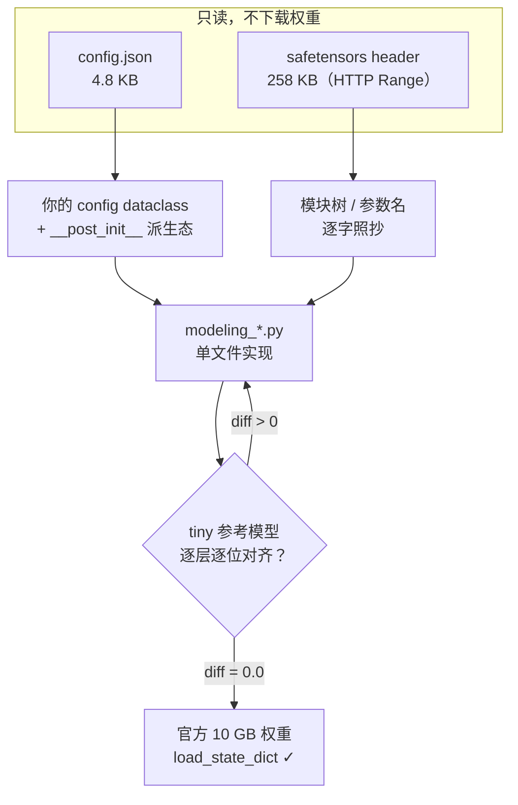

# hf-model-standalone

**把 HuggingFace 模型从 `transformers` 里抽出来，变成你能读懂、能改的一个文件。**

保证你写出来的东西**能直接吃官方权重**，而且能和官方实现**逐位对上**。

<p>
  <a href="LICENSE"></a>
  
  
</p>

已验证案例：`google/gemma-4-E2B`（5.1B，文本 + 视觉 + 音频）—— 46/46 项数值检查通过，
文本塔与视觉塔在 fp32 下 **logits diff = 0.0（逐位相同）**，greedy 生成的 token 与官方
`generate()` 完全一致。

---

## 问题：为了"能跑"，牺牲了"能读"

`transformers` 要同时支持 100+ 架构、3 种 attention backend、4 种 cache 策略、量化、编译、
张量并行。所以它的代码必然是分层的、带大量分支的。

这对**使用者**无害 —— `from_pretrained` 一行就能跑。但如果你想**读懂**或者**改**一个模型，
它会变成一堵墙。想知道"Gemma 4 的第 3 层到底做了什么"，你至少要在这些文件之间跳：

| 你想知道 | 实际要去看 |
| --- | --- |
| 这一层的 mask 从哪来 | `models/gemma4/modeling_gemma4.py` → `masking_utils.py` |
| KV 从哪来（共享层的） | `modeling_gemma4.py` → `cache_utils.py` |
| `rope_theta=1e6` 怎么变成角度 | `modeling_rope_utils.py` |
| `layer_types` 是谁算出来的 | `configuration_utils.py` 的 `__post_init__` |
| attention 到底怎么算的 | `integrations/sdpa_attention.py` —— **不在你读的那个文件里** |

于是：

- 一个 `forward` 里 6 个 `if`，你永远不确定自己的配置走的是哪条分支
- 改一个维度，shape 错误栈 40 层，一多半在框架内部
- debug 时无法区分"模型写错了"还是"框架分支没走到"

这不是 `transformers` 写得差。这是"通用性"必须付的代价。只是这个代价不该由**想学一个模型**的人来付。

## 解法：单文件 + 命名镜像 + tiny 对齐

三条硬约束，缺一不可：

**① 一个模型 = 一个文件。**
Gemma 4 全部代码（config 树 + 所有 `nn.Module` + forward + loss + 权重加载）在 1575 行里。
拆成 20 个模块后，"和参考实现对拍"会变成在 20 个文件间跳转 —— 成本远大于单文件的阅读成本。

**② 模块树和参数名逐字照抄参考实现。**
这是让"可读性"和"兼容官方权重"不再矛盾的关键。你不需要写任何 key 映射表，
`model.load_state_dict(hf_safetensors)` 直接就能用。想改架构？改完 shape，
权重加载器会明确告诉你哪几个 key 对不上，而不是静默出错。

**③ 用 tiny 参考模型做逐位对齐。**
不需要 GPU，不需要下载 10 GB。把维度缩到 32 隐藏层大小、保留**全部架构开关**，
用官方代码实例化一个随机初始化的模型，导出成真正的 `config.json + model.safetensors`，
再用你的实现加载、比对每一层的输出。



## 快速开始

```bash
git clone https://github.com/z777bw/hf-model-standalone
cd hf-model-standalone
```

```bash
# ① 只拉配置和预处理器（几 MB），绝不碰权重
python scripts/fetch_minimal.py google/gemma-4-E2B --out ./ckpt

# ② 不下载权重，直接看完整的参数树（2011 个 tensor / 5.123B 参数 / 10.25 GB）
python scripts/peek_checkpoint.py google/gemma-4-E2B

# ③ 造一个 1 MB 的 tiny 参考模型（架构开关全保留）
python scripts/make_tiny_reference.py ./ckpt --out ./tiny_ckpt
```

内地网络常见组合（`502 Bad Gateway` 基本都是本地代理，不是网站挂了）：

```bash
python scripts/fetch_minimal.py google/gemma-4-E2B --out ./ckpt \
       --endpoint https://hf-mirror.com --no-proxy
export HF_ENDPOINT=https://hf-mirror.com     # 给 transformers / hf_hub 用
```

三个脚本都接受**本地路径**，断网也能做参数树核对和 tiny 参考模型。

然后按 [`SKILL.md`](SKILL.md) 的六步走：config → 模块树 → forward 链 → 预处理 → 权重加载 → 对齐。
逐项打勾的版本在 [`references/checklist.md`](references/checklist.md)。

## 依赖：运行时不碰 transformers

| 阶段 | 需要什么 |
| --- | --- |
| **你的实现运行时** | `torch >= 2.0`、`numpy`、`pillow`、`tokenizers`、`safetensors` |
| **造 tiny 参考 / 对拍时** | 额外需要 `transformers` —— 它只当 oracle（标准答案），不进你的实现 |

这个区分很重要：`transformers` 只是"标尺"，交付物本身不依赖它。

## 怎么保证官方权重能用

镜像命名解决了 90% 的问题，剩下 4 件事必须手动处理（详见 [SKILL.md 第 4 节](SKILL.md)）：

1. **tied embeddings** —— `tie_word_embeddings=True` 的仓库不存 `lm_head.weight`，要从
   `embed_tokens.weight` 补
2. **冗余参数** —— 官方权重里留着模型运行时用不到的 key（KV 共享层的 `k_proj/v_proj/k_norm`）
3. **dtype** —— `config.json` 顶层的 `dtype` 会被 `from_pretrained()` 当作**默认加载精度**；
   对比时两边必须一致，否则你会追着 1e-2 的假差异跑一天
4. **persistent buffer** —— `layer_scalar`、`input_min/max`、`output_min/max` 都在 ckpt 里；
   `persistent=False` 的（`inv_freq` 等）不在，别去找

验证标准只有一条：**`report["missing"] == [] and report["unexpected"] == []`**。

## 推理：KV cache + 生成循环

抽出来的东西不该只能算 loss。`kv_cache.py` 和 `generation.py` 给了一个能读完、能替换的增量解码：

```python
from gemma4_standalone import generate

ids = generate(
    model, batch["input_ids"], max_new_tokens=32, do_sample=False,
    eos_token_id=[proc.tokenizer.eos_token_id],
    pixel_values=batch["pixel_values"],          # 只喂给 prefill
    image_position_ids=batch["image_position_ids"],
)
```

prefill 一次填满 cache，然后每次只算一个新 token 的 query。cache 就是"每层一对 `(k, v)`，
沿 seq 维 `cat`" —— 故意不优化，让你能一眼看完，然后把 `torch.cat` 换成预分配 buffer、
把 dynamic cache 换成 static cache、把 greedy 换成 beam search。

有三个坑只在接 cache 的时候才暴露：decode 时 query 的绝对位置是 `kv_len - q_len`（不是 0），
KV 共享层不写 cache 而是从共享字典读，`attention_mask` 必须覆盖全长而不是只传新 token。

## 已验证：Gemma 4

`examples/gemma4_standalone/` —— 从 transformers v5.16.1 逐行移植，运行时不 import transformers。

| 检查项 | max abs diff |
| --- | --- |
| tokenizer ids（中文 / emoji / 代码）、batch 左 padding、decode | 完全一致 |
| `pixel_values` / `image_position_ids` / `num_soft_tokens` | 5.96e-8 / 完全一致 / 一致 |
| 音频 log-mel + mask | 2.49e-4 / 完全一致 |
| 纯文本 logits + loss | **0.0** |
| 图像 + 文本 logits + loss | **0.0** |
| 音频 + 文本、图像 + 音频 + 文本 | ≤ 5.6e-7 |
| 权重加载 missing / unexpected / dropped | 0 / 0 / 6 |
| `use_cache=True` vs `False` 的整段前向 | **0.0** |
| 增量 decode vs 一次全序列 forward | 9.09e-7 |
| greedy 生成 token ids vs 官方 `generate()` | 完全一致 |

```bash
python examples/gemma4_standalone/test_parity.py     # ~30 s，CPU
```

真实 10 GB 权重的前向 + loss + 与 transformers 对拍：

```bash
python examples/run_gemma4_e2b.py --model-dir /data/models/gemma-4-E2B --compare-transformers
```

## 踩过的坑，都写下来了

移植过程中遇到的、**症状极具迷惑性**的问题，都在 [`references/pitfalls.md`](references/pitfalls.md)。
其中三条值得单独提：

- **`inv_freq` 不能注册成 buffer** —— `model.to(bf16)` 会舍入所有浮点 buffer，
  `bf16(0.1) = 0.10009765625`，之后 `.float()` 也救不回来。表现是 fp32 下逐位相同、
  bf16 下第一层就差 1e-2，而 `cos` 逐位对、`sin` 差 1 个 ulp。
- **官方实现自己也有 bug** —— `Gemma4AudioAttention` 里 `masked_fill(mask.logical_not(), -1e9)`
  期望 bool 掩码，但 eager 路径给的是 0/-inf 的 float 掩码，于是窗口内注意力退化成均匀平均。
  音频对齐要用 `sdpa`。
- **`config.to_dict()` 会丢字段** —— `global_head_dim` 被 `__post_init__` 吞进 `per_layer_config`，
  导出的 tiny 配置里没有它，full-attention 层的 head_dim 会静默变成默认值。

## 安装为 agent skill

这个仓库本身就是一个 skill。克隆到对应目录即可：

```bash
# Claude Code
git clone https://github.com/z777bw/hf-model-standalone ~/.claude/skills/hf-model-standalone

# WorkBuddy
git clone https://github.com/z777bw/hf-model-standalone ~/.workbuddy/skills/hf-model-standalone
```

之后说"把 Qwen3 从 transformers 里抽出来"之类的话，agent 会自动加载 `SKILL.md` 并按流程走。

## 目录结构

```
hf-model-standalone/
├── SKILL.md                  # agent 入口：工作流、抽取路线、权重加载、坑表
├── references/
│   ├── pitfalls.md           # A~G 七组坑位，★ 标注实测踩过的
│   ├── parity.md             # 数值对齐手册（含算子级定位法）
│   └── checklist.md          # 逐项打勾清单
├── scripts/
│   ├── hf_net.py             # 网络层：重试 / 绕代理 / 镜像 / 可读报错
│   ├── fetch_minimal.py      # 只拉配置和小文件
│   ├── peek_checkpoint.py    # HTTP Range 读 safetensors header，不下载权重
│   └── make_tiny_reference.py# 缩维造 tiny 参考模型
└── examples/
    ├── gemma4_standalone/    # 完整案例：单文件实现 + 预处理 + KV cache + 生成 + 对齐测试
    └── run_gemma4_e2b.py     # 真实权重的前向 + loss + 对拍
```

`scripts/` 下四个文件互相依赖（脚本共用 `hf_net.py`），单独拷走时要一起拷。

## 不做什么

- **不做生产级推理引擎。** KV cache 是"每层一对 tensor、沿 seq 维 append"的最小实现，
  提供 prefill / decode / greedy+采样。没有静态预分配、beam search、量化 cache、CUDA graph ——
  这些正好是留给读者的改造点，`kv_cache.py` 和 `generation.py` 末尾各列了一份清单
- **不追求覆盖所有架构。** 每个模型都要重新走一遍流程；脚本是架构无关的，坑位清单是经验积累的
- **不替代 `transformers`。** 它是生产环境该用的东西；这里产出的是**教学和改造用的副本**

## License

MIT。案例代码由 `transformers`（Apache-2.0）逐行移植而来，`modeling_gemma4.py` 头部注明了来源版本。
